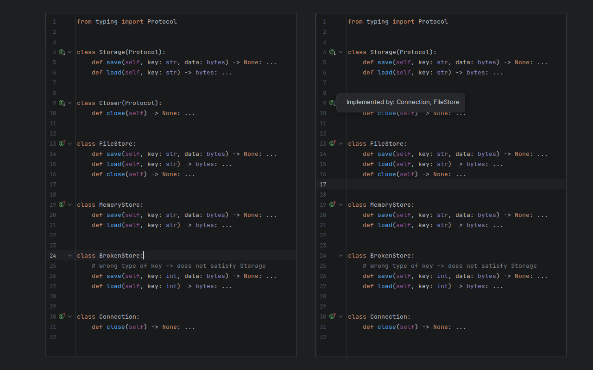
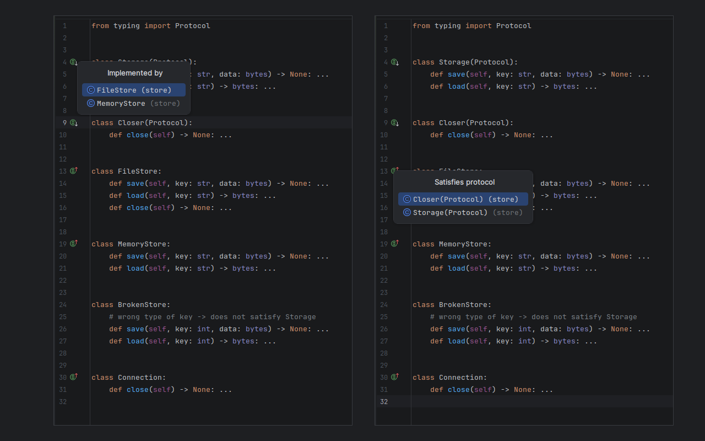

# Python Protocol Implementations

PyCharm plugin: shows which classes satisfy a `typing.Protocol` structurally (without inheriting it),
like GoLand does for Go interfaces.

- Gutter icon on a Protocol -> classes that implement it.
- Gutter icon on a class -> protocols it satisfies.
- Callback protocol (its only member is `__call__`): a gutter icon lists module-level functions with a matching
  signature (computed on click), and a function shows the callback protocols it satisfies.
  A `__call__(self, *args, **kwargs)` matches everything, so such protocols are skipped.
  `@overload` stubs are not functions of their own: only the implementation is listed.
- Go to Implementation (Ctrl+Alt+B) on a Protocol also lists implicit implementers and matching functions.
- Toggle: Settings | Editor | General | Gutter Icons | "Python Protocol: implicit implementations".

Matching is PyCharm's own `PyTypeChecker.match`, so the result agrees with what PyCharm
highlights for `x: Storage = FileStore()`. Only the file's git repository is searched (the nearest folder
with `.git` above it; outside git, its content root): libraries and other repos opened in the same project are left out.
The project needs a Python interpreter: without one `typing.Protocol` does not resolve and nothing is shown.

Protocols that plain `object` already satisfies (only `__hash__`, `__eq__`, `__str__`...) are skipped:
every class would match them.

Known limit: a class that inherits every protocol member from a base without declaring any itself
is not found (its base is).

## Build and run

Gradle needs JDK 25; PyCharm's bundled JBR works:

    export JAVA_HOME=~/programs/pycharm-2026.2.3/jbr
    ./gradlew test          # tests
    ./gradlew runIde        # sandbox PyCharm with the plugin
    ./gradlew buildPlugin   # build/distributions/*.zip -> Settings | Plugins | Install from Disk

## Publish to JetBrains Marketplace

1. Add a LICENSE file and decide the vendor/plugin id in `plugin.xml` (the id cannot change after the first upload).
2. Create a signing certificate: https://plugins.jetbrains.com/docs/intellij/plugin-signing.html
3. The first upload is manual at https://plugins.jetbrains.com/plugin/add (then a review, usually 1-2 business days).
4. Next versions:

       export CERTIFICATE_CHAIN=... PRIVATE_KEY=... PRIVATE_KEY_PASSWORD=... PUBLISH_TOKEN=...
       ./gradlew verifyPlugin publishPlugin
